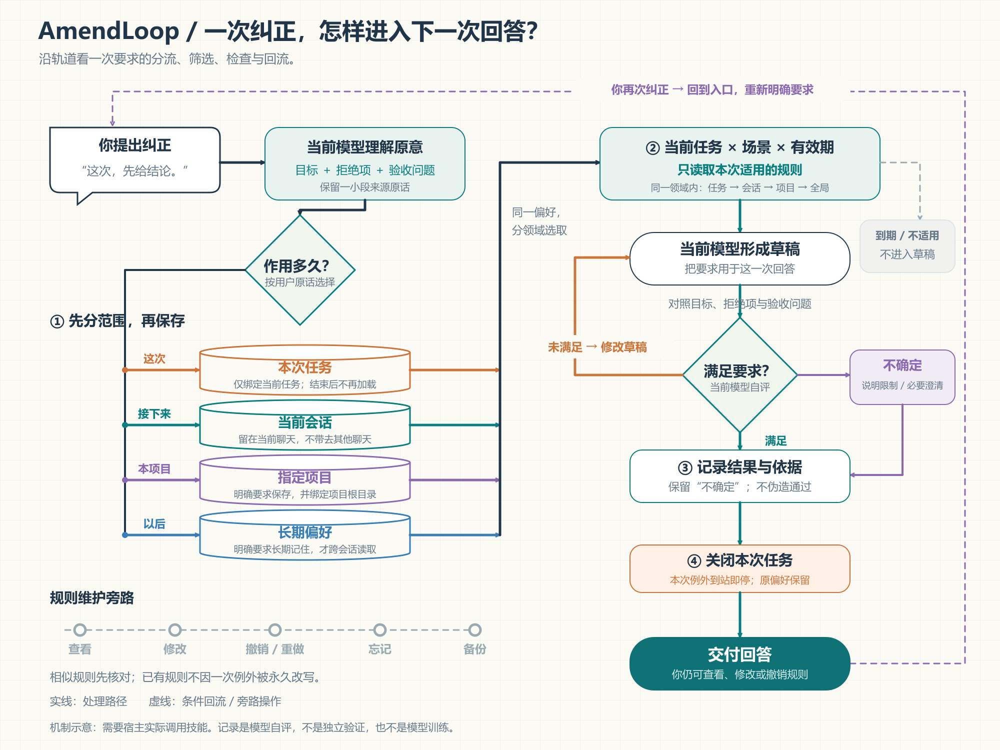
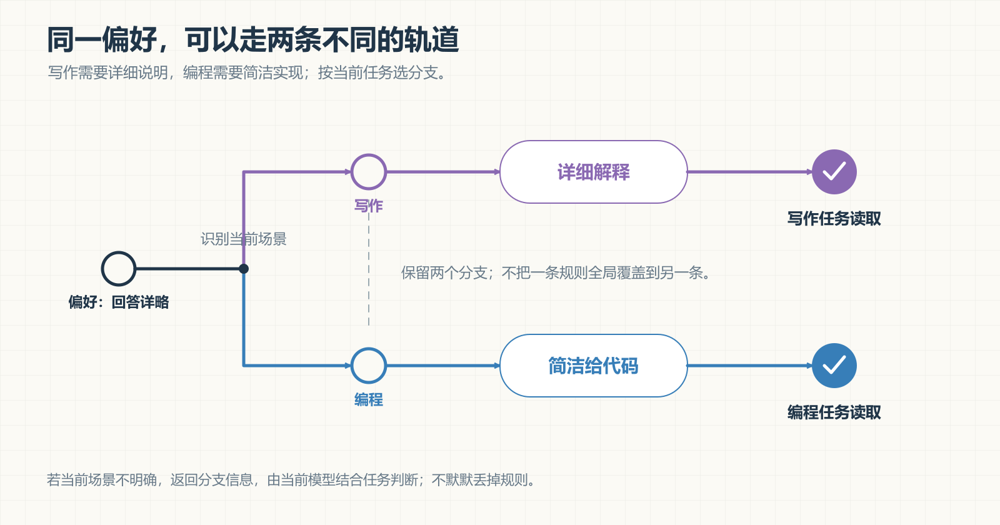
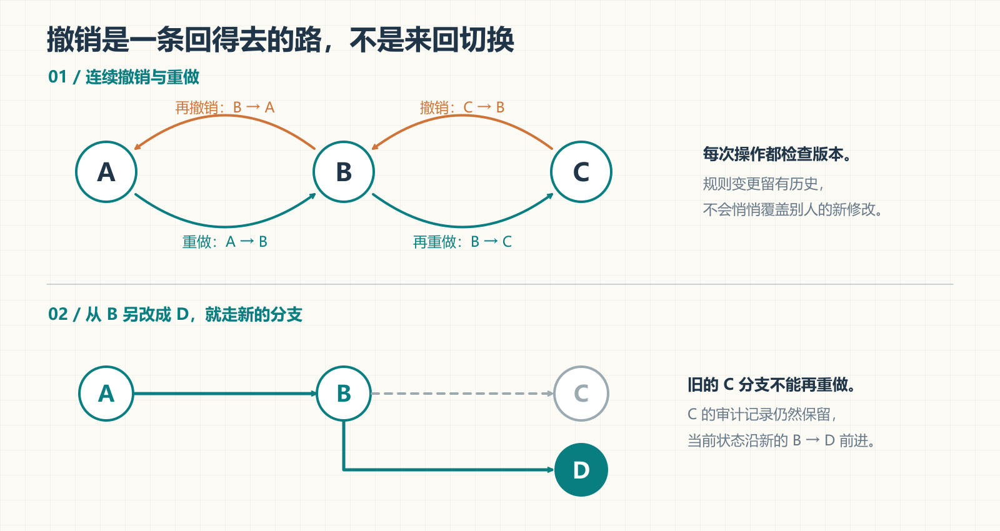

[README.md](https://github.com/user-attachments/files/34314537/README.md)

# AmendLoop

**Corrections that carry forward.**

把你的纠正，带进下一次回答。

AmendLoop is a local correction-memory skill for AI assistants, with scoped rules, inspectable checks, and reversible changes.



[打开可缩放的矢量流程图](assets/amendloop-route-map.svg)

AmendLoop（中文名：知改）是一款本地 AI 技能：把你说过的“不是这个意思”整理成有范围的要求，让当前模型在后续回答前读取、检查，并留下可查看的依据。

面向写作、学习、办公和编程中的日常沟通。你照常说话，规则的整理和使用由技能配合当前模型完成。

**版本：0.2.2 流程图与命名版** · **Python 3.10+** · **本地 SQLite** · **可选 MCP** · **MIT**

[快速开始](#快速开始) · [工作方式](#工作方式) · [常用说法](#常用说法) · [效果与验证](#效果与验证) · [详细使用说明](使用说明.md)

## 为什么叫 AmendLoop

**Amend** 是修正，**Loop** 是反馈循环：理解纠正、限定范围、用于后续回答，再根据新的反馈改进。

建议 GitHub 仓库名为 `amendloop`。中文名保留「知改」。现有安装目录、命令标识与调用名继续使用 `ai-correction-memory`，升级可保留已有配置和数据。

## 快速开始

需要允许本地技能或工具执行的 AI 宿主，以及可用的 Python 3.10+。核心技能不需要 API 密钥、不需要另一个模型，也不需要先安装 MCP SDK。

**1. 安装**

解压安装包，在这个 README 所在目录执行：

```powershell
python install.py
```

已有版本时升级：

```powershell
python install.py --upgrade
```

安装程序会核对旧文件、保护个人修改并备份旧程序。遇到权限限制时须由宿主授予目标目录权限。Windows 上若 `python` 是失效的别名，请使用实际 Python 的完整路径；详见[使用说明](使用说明.md#在-codex-安装)。

**2. 在新聊天中调用**

```text
使用 $ai-correction-memory，按我的纠正更新理解，回答前检查是否再次误解需求。
```

技能在界面中显示为 **「AmendLoop · 知改」**。是否自动选择它由宿主决定；显式调用最可靠。

**3. 照常表达要求**

```text
这次先给结论，再解释原因。
```

这是当前任务的例外。任务结束后恢复原偏好。如果你希望跨聊天保存，可以明确说：

```text
记住，以后回答都先给结论，再解释必要的依据。
```

普通纠正不会自动变成所有任务都适用的长期规则。

## 工作方式

主图有三个关键分岔：

- **范围分流**：按用户原话选择本次任务、当前会话、指定项目或长期偏好。
- **检查回路**：满足要求才交付；未满足返回草稿修改；不确定就说明限制，保留不确定状态。
- **反馈回流**：用户再次纠正后回到入口，重新明确要求；不会自动变成模型训练。

每条规则保存四类信息：

| 信息 | 例子 |
|---|---|
| 你要的结果 | 先给结论，再解释依据 |
| 已拒绝的做法 | 先铺陈很长的背景，末尾才回答 |
| 验收问题 | 第一段是否直接回答了问题？ |
| 来源与范围 | 用户原话；本次任务、当前会话、项目或长期偏好 |

本地工具负责存储、版本、检索和过程记录；当前聊天模型负责理解语义和检查回答。程序不会把“没有命中禁用词”当作语义检查通过。

## 检查过程可以追踪

你可以随时问：**“刚才哪些规则实际生效了？”**

AmendLoop 区分“已读取”“已扫描草稿”“模型自报满足”“需要修改”“不确定”。调用过工具和完成检查，是不同阶段。检查记录包括简短依据；它依然是模型自评，不能当作独立验证。

## 记忆用在正确的范围



同一偏好的写作版和编程版会分别保留。在每个领域内，依次由任务、会话、项目、全局规则处理覆盖。你当前明确提出的要求优先于保存的偏好。

## 撤销也有自己的路线



连续撤销沿状态历史后退，重做沿当前分支前进。从旧状态另作修改会形成新分支；相应旧重做分支不再可用，但审计事件保留。每次操作都检查版本，避免覆盖后来的修改。

## 常用说法

| 你说 | AmendLoop 如何处理 |
|---|---|
| “不是这个意思，我要……” | 更新当前理解，整理纠正与验收问题 |
| “只这次这样做” | 绑定当前任务，结束后不继续套用 |
| “这个项目以后都这样” | 保存项目规则，保留你的保存原话 |
| “记住，以后都这样” | 保存跨会话偏好 |
| “你记住了什么？” | 列出规则和适用范围 |
| “撤销刚才的修改 / 重做” | 沿规则历史后退 / 前进 |
| “这条规则只用到这个日期” | 设置带时区的有效期 |
| “清理重复规则” | 提供候选；合并确认的完全相同行为，保留来源 |
| “忘掉这条规则” | 删除指定规则及数据库内相关历史与生效记录 |
| “备份 / 导出我的规则” | 创建一致性快照或可迁移的 JSON 文件 |

当前任务与会话规则也会落盘，只是使用范围受限。独立备份和导出文件不会随单条规则删除而自动消失。

## 支持哪些使用方式

| 方式 | 当前状态 |
|---|---|
| Codex 本地技能 | 已安装、验证；使用 `$ai-correction-memory` 调用 |
| Python 命令行 | 可独立管理规则；核心只用标准库 |
| MCP stdio 工具 | 提供 13 个工具，实际接口往返测试通过；需安装可选 SDK |
| 其他开放本地工具或 MCP 的宿主 | 可接入，需要按宿主配置，未逐一验证 |
| 未开放接入能力的普通聊天网页 | 本包不能自动注入或截获其聊天 |

MCP 安装与配置见[使用说明](使用说明.md#可选-mcp-接入)，命令及规则格式见[命令参考](references/commands.md)。

## 效果与验证

v0.2 核心完成了 **57 项自动化测试，零失败、零跳过**，覆盖存储、范围、撤销、迁移、升级和实际 MCP 接口。本次 0.2.2 更新英文名称、机制流程图、文档与版本标识，保留原始测试记录及核心验收报告。

另有 12 个模拟对话的独立匿名对照评测：

| 场景 | 基线满足偏好 | 技能组满足偏好 |
|---|---:|---:|
| 同一聊天已有纠正 | 4 / 4 | 4 / 4 |
| 新聊天取回长期偏好 | 6 / 8 | 8 / 8 |
| 合计 | 10 / 12 | 12 / 12 |

这是小样本的偏好保留结果。新聊天的基线未获得旧偏好，不符合旧偏好不等于回答当前问题错误。本次没有证明同一聊天内的额外收益，也没有真实用户长期纠正次数的数据。

[核心验收报告](验收报告.md) · [原始测试结果](test-results.json) · [评测方法与限制](evals/评测方法.md) · [逐项评分](evals/summary.json)

## 数据与开源组件

- **本地 SQLite / FTS5**：保存规则、历史和生效记录，提供词项检索。[SQLite 文档](https://www.sqlite.org/fts5.html)，[公共领域说明](https://www.sqlite.org/copyright.html)。
- **官方 MCP Python SDK**：可选工具接入，固定为 `mcp==1.30.0`。[开源项目](https://github.com/modelcontextprotocol/python-sdk)，MIT 许可证；通过包管理器安装，本包不复制其源码。
- **AmendLoop 自有实现**：规则范围、分场景覆盖、多步撤销重做、自评记录、整理、迁移、升级保护及技能工作流。

应用不向外部服务发送规则；规则被工具取回后会进入当前宿主的模型上下文。本地数据库未加密，生效记录可能包含规则原文和简短回答依据。数据位置和备份管理见[使用说明](使用说明.md#数据位置与迁移)。

本项目及原创视觉素材采用 [MIT 许可证](LICENSE)。`assets/` 同时提供 README 使用的 PNG 和可编辑 SVG；图中箭头表达流程、条件分支与反馈回路，而不是产品界面截图。

## 开发与复现

```powershell
python -m unittest discover -s tests -v
python scripts/demo.py
```

未安装可选 MCP SDK 时，对应测试会明确跳过。独立评测的输入、匿名答案和评分脚本在 `evals/`，复现步骤见[评测方法](evals/评测方法.md)。

## 使用边界

AmendLoop 帮助保存和使用纠正，不能强制所有宿主自动调用，也不能保证模型永不误解。模型自评可能不准确；过期或冲突的规则仍需根据当前任务处理。它不会改变模型权重、输入能力或上下文上限。

如果你发现新的误用，可以保留“用户要求 → 实际回答 → 期望行为”的最小示例，先删除个人信息，再用于本地复现和改进。
